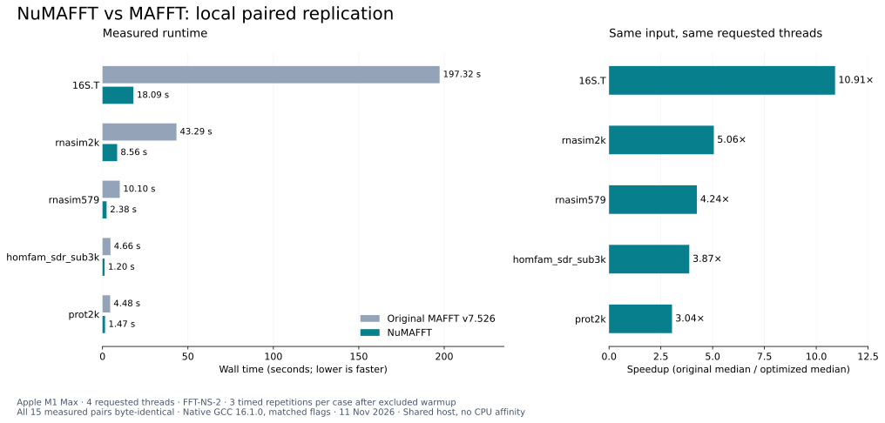

# Benchmarks

[NuMAFFT README](README.md#benchmarks)

## Local paired measurements



[Download figure as PDF](bench/biocode/figures/numafft-local-4threads.pdf). Three measured repetitions per case; 15/15 measured pairs were byte-identical.

Default FFT-NS-2, upstream MAFFT v7.526 versus the optimized implementation distributed here as NuMAFFT. The project rename and documentation rewrite do not change the measured alignment code. Raw records retain the original binary paths and source revision.

| Dataset | Requested threads | Original MAFFT, s | NuMAFFT, s | Speedup | Matching pairs |
| :--- | ---: | ---: | ---: | ---: | :--- |
| prot2k | 1 | 13.534 | 4.734 | 2.86× | 3/3 |
| rnasim579 | 1 | 29.329 | 8.678 | 3.38× | 3/3 |
| 16S.T | 4 | 197.324 | 18.092 | 10.91× | 3/3 |
| homfam_sdr_sub3k | 4 | 4.659 | 1.203 | 3.87× | 3/3 |
| prot2k | 4 | 4.478 | 1.474 | 3.04× | 3/3 |
| rnasim2k | 4 | 43.292 | 8.562 | 5.06× | 3/3 |
| rnasim579 | 4 | 10.100 | 2.382 | 4.24× | 3/3 |

Wall times are medians of three measured repetitions after one excluded warmup per variant and case. Speedup is original median divided by optimized median. All 21 measured pairs and seven warmup pairs had byte-identical stdout. Outputs also preserved the input headers and ungapped sequences and formed rectangular alignments.

### Hardware and run settings

| Setting | Value |
| :--- | :--- |
| Date | 11 November 2026 |
| CPU | Apple M1 Max, eight performance and two efficiency cores |
| RAM and OS | 32 GiB; macOS 26.5.2, arm64 |
| Compiler | Homebrew GCC 16.1.0 |
| Both builds | `-O3 -ffp-contract=off -std=c99`; native arm64 |
| Baseline | MAFFT v7.526, `ee9799916df6a5d5103d46d54933f8eb6d28e244` |
| Imported optimized source | fast-mafft v10, `6474c62da49ca3af73bbb7b05287bbbb4a2036e5` |
| Command | `mafft --thread N input.fa` |
| Timing | Launcher, alignment and stdout writing included |
| Order | One invocation at a time; measured order AB, BA, AB |
| Cache | One excluded warmup each; OS caches not flushed |

`--thread N` requests workers. These local runs did not reserve N physical cores or pin workers to particular cores. The machine was shared, and background activity and thermals were uncontrolled. Single-thread and four-thread results are compared only within their own rows.

### Data and correctness

RNASim is simulated RNA, and prot2k is generated protein data. HomFam SDR is a biological protein-family sample; 16S.T is biological rRNA. Input sizes, SHA-256 values, sources and licenses are in the [detailed record](bench/biocode/REPORT.md) and [data notes](bench/DATA.md). Output agreement is against the pinned upstream build; reference-based biological accuracy was not measured.

### CPU time, memory and spread

The [CSV](bench/biocode/measurements.csv) records each invocation, including CPU time and excluded warmups. The [summary](bench/biocode/summary.json) gives medians, min/max wall times, paired speedups and maximum child RSS. Memory is the largest child-process high-water RSS per invocation, not simultaneous process-tree memory. Darwin bytes and Linux KiB are normalized to bytes; the detailed report uses MiB. No confidence interval is claimed.

## Historical CARC measurements

The imported project contains three repetitions on 12 large datasets at 32 allocated CPU cores on USC CARC. The table below was regenerated from the retained logs. These HPC jobs were not rerun during the local replication.

AMD EPYC 7513, 64 GB job memory, GCC 13.3.0, `-O3 -march=native -flto`, default FFT-NS-2, `--thread 32`. Original and optimized runs were paired within each job. The speedup statistic here is the arithmetic mean of the three paired ratios, so it differs from the ratio of medians used above.

| Dataset | Allocated cores | Original mean, s | Optimized mean, s | Mean paired speedup | Matching output hashes |
| :--- | ---: | ---: | ---: | ---: | :--- |
| rnasim5k | 32 | 44.1 | 4.4 | 10.10x | yes (3/3) |
| rnasim10k | 32 | 94.1 | 8.1 | 11.68x | yes (3/3) |
| 16S.T | 32 | 58.6 | 5.1 | 11.57x | yes (3/3) |
| 16S.3 | 32 | 46.7 | 4.0 | 11.68x | yes (3/3) |
| homfam_p450 | 32 | 140.7 | 6.5 | 21.77x | yes (3/3) |
| rnasim20k | 32 | 231.9 | 17.3 | 13.38x | yes (3/3) |
| 16S.B.ALL | 32 | 505.1 | 17.6 | 28.70x | yes (3/3) |
| homfam_sdr | 32 | 269.1 | 12.1 | 22.19x | yes (3/3) |
| homfam_Acetyltransf | 32 | 172.9 | 9.0 | 19.22x | yes (3/3) |
| rnasim25k | 32 | 1189.3 | 27.1 | 43.85x | yes (3/3) |
| homfam_rvp | 32 | 892.6 | 25.0 | 36.04x | yes (3/3) |
| rnasim50k | 32 | 2517.5 | 72.1 | 34.95x | yes (3/3) |

All 36 timed pairs for these 12 datasets had matching output hashes. The source code under `fast-mafft-src/` is unchanged between the original CARC source revision `b35964d` and the imported revision listed above. [Regenerated table](bench/biocode/evidence/carc-regenerated.md) · [original logs](carc/logs/).

### Known output difference

A separate historical SARS-CoV-2 case with 2,000 genomes reported a 205.29-fold timing speedup, but only two of three timed output pairs matched. It is not included in the equivalent-output speedup range. The source documents timing-dependent multithread behavior when an alignment crosses 30,000 columns mid-pass. The local test did not repeat that case. Validate new inputs, especially when exact reproducibility is required.

## Reproduce the local comparison

Requires Python 3.11 or later, Git, make and a C compiler. From this checkout:

```sh
CC=/opt/homebrew/bin/gcc-16 sh bench/biocode/build.sh /absolute/path/to/new-build-directory
bash bench/get_data.sh
python3 bench/biocode/run.py \
  --baseline /absolute/path/to/new-build-directory/baseline/bin/mafft \
  --optimized /absolute/path/to/new-build-directory/optimized/bin/mafft \
  --baseline-source /absolute/path/to/new-build-directory/upstream-source \
  --optimized-source /absolute/path/to/new-build-directory/optimized-source \
  --compiler 'Homebrew GCC 16.1.0' \
  --cflags='-O3 -ffp-contract=off -std=c99' \
  --threads 4 --repetitions 3 --timeout 600 \
  --out bench/biocode/results/your-machine-4threads \
  bench/data/rnasim579.fa bench/data/rnasim2k.fa bench/data/prot2k.fa \
  bench/data/large/homfam_sdr_sub3k.fa bench/data/large/16S.T.fa
```

The build script rebuilds the pinned precursor revision whose alignment source NuMAFFT imports unchanged. It uses matching compiler options for the upstream and optimized builds. The local source can also be built directly using the [quick start](README.md#quick-start). C99 is explicit because GCC 16 rejects a legacy declaration under its default dialect.

Repeat with `--threads 1`, only rnasim579 and prot2k, and a new output directory for the single-thread suite. Run suites sequentially. Recorded results were produced with the retained `run.py`; the publication packaging does not rewrite their commands or measured values.

```sh
python3 -m unittest discover -s bench/biocode -p 'test_*.py' -v
```

Eight runner/report/website checks cover sequence loss, duplicate headers, invalid alignment shape, timeout, incomplete evidence, output differences incompatible build flags and preservation of existing website entries. They are checks of the measurement tooling, not a full audit of MAFFT.

## Evidence files

- [Per-run CSV](bench/biocode/measurements.csv) and [summary JSON](bench/biocode/summary.json).
- [Run directories](bench/biocode/results/): manifests, exact commands, SHA-256 values, stderr and stdout archives. Identical stdout contents use tar hardlinks, retaining all per-run filenames.
- [Build logs and checks](bench/biocode/evidence/).
- [Data and output notices](bench/biocode/THIRD_PARTY_NOTICES.md).

The measurements cover default FFT-NS-2. Other strategies and additional platforms require separate tests. Faster execution does not establish lower memory usage on every workload or better alignment accuracy.
