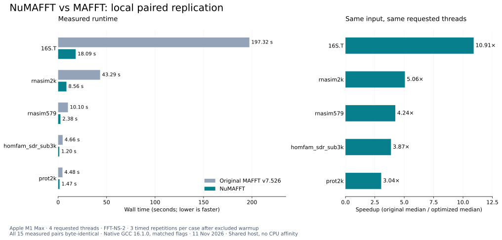

<div align="center">

# NuMAFFT

**Multiple sequence alignment with a faster default MAFFT workflow.**

<a id="contents"></a>

<p align="center">
  <a href="#quick-start">Quick start</a> &nbsp;·&nbsp;
  <a href="#usage-and-parameters">Usage</a> &nbsp;·&nbsp;
  <a href="#implementation-status-and-roadmap">Implementation status and roadmap</a> &nbsp;·&nbsp;
  <a href="#benchmarks">Benchmarks</a>
  <br>
  <a href="#ai-use-and-review">AI use and review</a> &nbsp;·&nbsp;
  <a href="#questions-and-contributions">Questions and contributions</a> &nbsp;·&nbsp;
  <a href="#acknowledgments-and-references">References</a>
</p>

</div>

NuMAFFT is BioCode Commons' MAFFT project. It incorporates the optimized FFT-NS-2
implementation from fast-mafft v10, based on MAFFT v7.526. The executable remains `mafft`.

On five datasets tested on Apple M1 Max with four requested threads, the optimized
implementation showed speedups of 3.04 to 10.91 over upstream v7.526. All 15
measured output pairs were byte-identical. A separate two-dataset single-thread test
showed 2.86 to 3.38 times speedup, also with matching output. See [methods and raw evidence](BENCHMARKS.md).

<a id="quick-start"></a>

## Quick start <sup><sub>[↑ Contents](#contents)</sub></sup>

### 1. Build

Requires a C compiler, make, and a POSIX system. The tested local build uses Homebrew
GCC 16.1.0 on arm64 macOS. Choose an empty installation directory:

```sh
make -C fast-mafft-src/core clean
make -C fast-mafft-src/core -j4 CC=gcc CFLAGS='-O3 -ffp-contract=off -std=c99' PREFIX=/absolute/path/to/numafft
make -C fast-mafft-src/core install CC=gcc CFLAGS='-O3 -ffp-contract=off -std=c99' PREFIX=/absolute/path/to/numafft
```

On the tested Mac, use `CC=/opt/homebrew/bin/gcc-16` in both build commands. Use the same
`PREFIX` when building and installing: the launcher embeds that location. The internal
`fast-mafft-src/` directory retains the imported source layout.

### 2. Align sequences

```sh
/absolute/path/to/numafft/bin/mafft --thread 4 input.fa > aligned.fa
```

Use an unaligned nucleotide or protein FASTA as input. The aligned FASTA is written to
stdout; progress and diagnostics are written to stderr.

<a id="usage-and-parameters"></a>

## Usage and parameters <sup><sub>[↑ Contents](#contents)</sub></sup>

| Setting | Use |
| :--- | :--- |
| `--thread N` | Request N workers; compare both versions with the same N |
| No strategy option | Select the default FFT-NS-2 workflow evaluated here |
| `--thread 1` | Use the tested single-thread path; validate outputs for your own data |
| `--help` | Show MAFFT's command-line help |
| `--version` | Reports the upstream base version, v7.526 |

The interface retains MAFFT v7.526 options. The acceleration measurements cover
default FFT-NS-2. Other strategies need their own performance checks.

<a id="implementation-status-and-roadmap"></a>

## Implementation status and roadmap <sup><sub>[↑ Contents](#contents)</sub></sup>

| Area | Current status |
| :--- | :--- |
| Optimized alignment source | Imported from fast-mafft v10; alignment code unchanged in this packaging |
| Local runtime and output comparison | Complete: seven input/thread cases, three measured pairs each |
| Original CARC evidence | Logs retained and table regenerated; those HPC jobs were not rerun here |
| Long-alignment multithread corner case | Output differences are documented; see the compatibility note below |
| Comprehensive human code audit | Pending |
| Wider strategy and platform validation | Pending |

The implementation accelerates distance calculations, guide-tree construction,
progressive alignment and output processing. It uses SIMD and bit-parallel distance
kernels, candidate lists for guide trees, combined dynamic-programming loops, deferred
gap insertion and parallel scheduling. Version 10 also changes the long-genome
alignment and anchor-search paths. [Implementation notes](docs/IMPLEMENTATION.md)
describe the imported changes and their scope.

### Compatibility note

The source documents timing-dependent output differences with multiple threads when
an alignment crosses 30,000 columns during a progressive pass. In one historical
2,000-genome SARS-CoV-2 benchmark, only two of three timed output pairs matched.
The reported 205-fold timing result for that case is not an equivalent-output claim.
The local test here did not include that case. Validate your inputs before replacing
an established analysis.

Next work includes additional input and strategy checks, controlled Linux repetitions,
and human review of the optimized kernels and scheduling changes.

<a id="benchmarks"></a>

## Benchmarks <sup><sub>[↑ Contents](#contents)</sub></sup>



[Download figure as PDF](bench/biocode/figures/numafft-local-4threads.pdf). Three measured repetitions per case; 15/15 measured pairs were byte-identical.

Apple M1 Max, GCC 16.1.0, default FFT-NS-2; each row uses the same input and thread count
for both versions. Times are medians of three measured runs after an excluded warmup.

| Dataset | Requested threads | Original MAFFT → NuMAFFT | Speedup | Output comparison |
| :--- | ---: | ---: | ---: | :--- |
| RNASim, 579 simulated RNA sequences | 1 | 29.329 → 8.678 s | 3.38× | Byte-identical, 3/3 |
| Simulated protein, 2,000 sequences | 1 | 13.534 → 4.734 s | 2.86× | Byte-identical, 3/3 |
| RNASim, 579 simulated RNA sequences | 4 | 10.100 → 2.382 s | 4.24× | Byte-identical, 3/3 |
| RNASim, 2,000 simulated RNA sequences | 4 | 43.292 → 8.562 s | 5.06× | Byte-identical, 3/3 |
| Simulated protein, 2,000 sequences | 4 | 4.478 → 1.474 s | 3.04× | Byte-identical, 3/3 |
| HomFam SDR, 3,000 protein sequences | 4 | 4.659 → 1.203 s | 3.87× | Byte-identical, 3/3 |
| 16S.T, 7,350 rRNA sequences | 4 | 197.324 → 18.092 s | 10.91× | Byte-identical, 3/3 |

Threads were requested through `--thread`; the workstation had no exclusive core
allocation or CPU affinity. The original 32-core CARC runs are reported separately
in [BENCHMARKS.md](BENCHMARKS.md#historical-carc-measurements), with 10.10 to 43.85 times
mean paired speedup on 12 large datasets. Hardware and summary statistics differ
between the two evaluations.

<a id="ai-use-and-review"></a>

## AI use and review <sup><sub>[↑ Contents](#contents)</sub></sup>

| Item | Status |
| :--- | :--- |
| Current packaging and documentation | AI-assisted; benchmark records retained |
| Comprehensive human code audit | Pending |
| Output checks | Completed for the listed inputs and configurations |

<a id="questions-and-contributions"></a>

## Questions and contributions <sup><sub>[↑ Contents](#contents)</sub></sup>

Visit [BioCode Commons](https://biocode-commons.github.io/) for the project collection
and contact information. Useful contributions include reproducible failure cases,
performance measurements on other machines, and review of the alignment changes.

<a id="acknowledgments-and-references"></a>

## Acknowledgments and references <sup><sub>[↑ Contents](#contents)</sub></sup>

MAFFT was developed by Kazutaka Katoh and collaborators. The imported optimizations
are from Yihan Hong's [fast-mafft v10](https://github.com/yih0nk/fast-mafft), source
revision `6474c62da49ca3af73bbb7b05287bbbb4a2036e5`. NuMAFFT's packaging does not change
that algorithm implementation.

- [MAFFT software and citation guidance](https://mafft.cbrc.jp/alignment/software/)
- [Upstream v7.526 source](https://gitlab.com/sysimm/mafft/-/tree/ee9799916df6a5d5103d46d54933f8eb6d28e244)
- [Data sources and licenses](bench/DATA.md)

The project's [BSD terms are in NOTICE.md](NOTICE.md#license-terms). Original copyright and third-party
notices remain in [NOTICE.md](NOTICE.md), `fast-mafft-src/license` and
`fast-mafft-src/license.extensions`.
